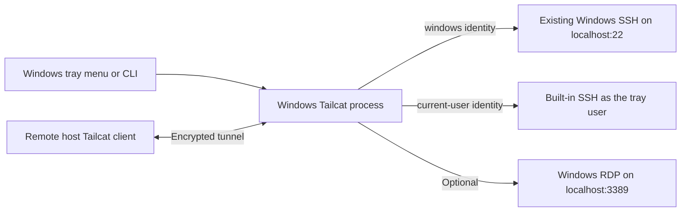

# Tailcat Tray

Windows tray app and CLI for controlling Tailcat SSH and RDP tunnels. Uses the bundled .NET Framework and WinForms. Public Tailcat relays are free, rate-limited, and best effort.

## Architecture and identities

The app supports standalone interactive operation or an automatic Windows service. Without the service, `TailcatTray.exe` owns the Tailcat child process. With the service installed, `TailcatTunnel` owns it and the tray/CLI become controllers. `tailcat-tray.exe` is this app's console client, not the upstream `tailcat` executable. Keep the tray and CLI executables together.



Tailcat uses a DERP relay (Designated Encrypted Relay for Packets) for initial rendezvous and attempts a direct encrypted UDP path between the peers. If direct connectivity fails, the relay carries encrypted packets. This application does not require either device to join a Tailscale account or tailnet. It still needs network access to the selected relay.

Three different keys have different jobs:

| Key | Kept on | Purpose |
| --- | --- | --- |
| Server key, for example `home-pc` | Windows | Identifies the home server and, with a fixed region, keeps its address stable. |
| Client key, normally `client-default` | Remote host | Proves that the connecting device is in the tunnel's allowlist. Its **public** `nodekey:...` value goes into Windows `MacKeyPath`. |
| SSH key | Remote host | Authenticates an SSH login after the tunnel is established. Its **public** `ssh-ed25519 ...` or other supported key line goes into the relevant authorized-keys file. |

Do not substitute an SSH public key for a Tailcat node key. Do not copy any private key between machines for this setup.

## First-time setup

1. Install upstream Tailcat on the Windows server and the remote host using the [installation instructions](https://github.com/tailscale/tailcat/blob/main/INSTALL.md) for each operating system, and build the tray executables using the instructions below if they are absent.
2. On the remote host, inspect existing identities with `tailcat genkey --list`. If `client-default` does not already exist, create it with `tailcat genkey --client --key=client-default`. Use `tailcat printpub` to print the active client's public key. Preserve an existing client identity rather than overwriting it.
3. On Windows, save that one `nodekey:...` public-key line in a file and set `MacKeyPath` to its absolute path. The default is `~\.config\tailcat\nodekeys` in the Windows user's profile.
4. Choose an SSH identity using the table below and authorize the remote host's SSH public key for that server. For `windows`, an SSH service must already listen on localhost port 22. For `current-user`, set `SshAuthorizedKeysPath` to an existing authorized-keys file. Windows administrators normally use `C:\ProgramData\ssh\administrators_authorized_keys`; ordinary Windows SSH users normally use their profile's `.ssh\authorized_keys`. Keep the permissions required by Windows OpenSSH.
5. Run the tray once, then quit it before editing `~\.config\tailcat-tray\settings.json`. Set actual paths using `settings.example.json` as a reference; `YOUR_USER` is a placeholder. The generated defaults use `ServerKey: new`; the example uses `home-pc`, which must first be created as described below.
6. If RDP is needed, enable Windows Remote Desktop separately and confirm the intended account can log in. The tray only forwards the port; it does not configure RDP or grant login rights.

| SSH identity | Windows account used | SSH public key checked by |
| --- | --- | --- |
| `windows` | The username supplied by the remote host, e.g. `remote-user` | Existing Windows OpenSSH configuration |
| `current-user` | The account running the tray, including an Entra/RDP account | Tailcat using `SshAuthorizedKeysPath` |

The `current-user` option does not switch Windows users based on the SSH username. To change that identity, run the tray under the intended Windows account.

## Run

Double-click `TailcatTray.exe` in your normal Windows RDP session. Standalone mode starts **disabled**; service mode displays the service's current state. Find the terminal icon in the tray or its hidden-icons overflow. Either mouse button opens the menu.

- **Disabled:** stop the tunnel owned by this app.
- **SSH only / SSH + RDP:** enable the selected SSH service, optionally forwarding RDP port 3389.
- **SSH identity:** in standalone mode, select Windows accounts or the current tray user. The boot service supports Windows accounts only; it never provides a shell under its service account.
- **Copy address:** copy the address once Tailcat is ready.
- **View log:** open a built-in log window that refreshes every second.
- **Quit:** in standalone mode, stop the owned tunnel and exit. In service mode, close only the tray; the tunnel keeps running.

Gray means disabled, amber means starting, and green means Tailcat reported its address. Green does not verify a remote SSH/RDP login. Failed startup times out after 45 seconds. Disable and Quit do not stop Tailcat processes launched outside this app. A Windows job object terminates the owned Tailcat process if the tray exits or is terminated.

In service mode, the service owns the job object. It retries failed tunnel starts after 10 seconds; Windows service recovery restarts a failed service. Closing or terminating the tray does not stop that tunnel.

### Start the tray automatically at login

Run as the Windows user who should see the tray, without administrator elevation:

```powershell
powershell -NoProfile -ExecutionPolicy Bypass -File .\set-tray-startup.ps1
```

This registers `TailcatTray.exe` from this folder in the current user's Windows Run key. After login, the icon displays the service's current status; the service itself starts before login. Keep the executable at this path, or rerun the script after moving it. Startup does not enable a disabled tunnel. Windows may put the icon in the tray overflow.

To remove only the login startup entry:

```powershell
powershell -NoProfile -ExecutionPolicy Bypass -File .\set-tray-startup.ps1 -Disable
```

This does not stop the service or the currently running tray. Service uninstall leaves this per-user preference intact; disable it separately if removing the tray too.

## Automatic service: access before Windows login

The service runs as `NT AUTHORITY\LocalService` in session 0, starts automatically, and forwards the existing Windows SSH server (port 22), optionally with RDP (3389). SSH authenticates the requested Windows account. RDP authenticates its own Windows login independently. The interactive current-user SSH option is unavailable while the service is installed.

Build first, then run the following in **Administrator PowerShell**, substituting the saved key filename if different. `$controllerSid` must identify the Windows account that will operate the tray/CLI; if you elevated using a different administrator account, obtain the intended user's SID from that user's `whoami /user` instead.

```powershell
$controllerSid = [Security.Principal.WindowsIdentity]::GetCurrent().User.Value
.\install-service.ps1 `
  -UserSettingsPath "$env:USERPROFILE\.config\tailcat-tray\settings.json" `
  -ServerKeyPath "$env:APPDATA\tailcat\keys\home-pc.private.json" `
  -ControlSid $controllerSid `
  -Mode ssh-rdp
```

Use `-Mode ssh` to expose only SSH. The installer requires an existing saved server key, valid client allowlist, and the Windows SSH/RDP services. It refuses to overwrite an existing installation. It makes SSH and Remote Desktop start automatically without restarting a running RDP service, records their previous startup types, and configures Tailcat service recovery.

| Location | Contents and access |
| --- | --- |
| `%ProgramFiles%\TailcatTray` | Service executable and pinned Tailcat executable; service can read/execute, administrators can update. |
| `%ProgramData%\TailcatTray\service.json` | Service configuration and authorized controller SID; service can read, administrators can modify. |
| `%ProgramData%\TailcatTray\server.private.json` | Copy of the saved server identity; readable by the dedicated service SID, SYSTEM, and Administrators. |
| `%ProgramData%\TailcatTray\client.pub` | Copied remote-host allowlist key. |
| `%ProgramData%\TailcatTray\state` | Persisted mode and logs; service can modify, controller can read. |

The original user settings and private key remain untouched in the user profile. A copy avoids giving the service access to that profile. Rotating the original key or changing user settings does **not** update the installed service: its protected copies are authoritative. To update configuration or rotate keys, stop the service and update the protected service files as an administrator, or uninstall and reinstall from the updated user configuration. Changing the server key changes its address; distribute the new address privately.

The same CLI controls the service even when the tray is closed:

```powershell
.\tailcat-tray.exe enable ssh-rdp
.\tailcat-tray.exe status
.\tailcat-tray.exe address
.\tailcat-tray.exe disable
```

Enable and Disable persist across service restarts and Windows reboots. **Disable means it stays disabled after reboot.** Enable the desired mode before leaving. `quit` closes only the tray. `identity current-user` returns an explanatory error in service mode. Administrators can use `Restart-Service TailcatTunnel` for maintenance. A logged-in desktop is not required, but Windows must boot successfully and have network access.

The local control pipe grants access to the configured controller and dedicated service SID. It excludes the shared LocalService SID and restricts implicit owner rights. It accepts only fixed control commands, not executable paths or arbitrary shell commands.

### Uninstall

In **Administrator PowerShell**:

```powershell
.\uninstall-service.ps1 -WhatIf
.\uninstall-service.ps1
```

Uninstall stops/deletes the service, deletes its executable directory and **all service data including the copied private key, settings, logs, and mode**, and restores the prior SSH/RDP startup types if they still match the installer's Automatic setting. It does not stop existing SSH/RDP services, remove the repository, or modify the original user settings/key. No service-data backup is retained. Restart the tray afterward to return to standalone mode.

Service restart without a tray, stable-address reuse, child-crash recovery, persisted disable state, cross-user access denial, and uninstall/reinstall have been exercised locally. The operator also confirmed a successful SSH connection after a full Windows reboot. RDP after reboot has not yet been tested.

## User settings

Live settings belong to the Windows user running the app:

```text
~\.config\tailcat-tray\settings.json
```

The repository contains only `settings.example.json`. Missing settings are initialized with defaults; restart the tray after editing the file manually. Menu and CLI identity changes are saved automatically.

| Setting | Purpose |
| --- | --- |
| `TailcatPath` | Full path to the real Tailcat executable, not a package-manager shim. |
| `MacKeyPath` | File containing one allowed remote host `nodekey:` public key. The existing setting name is retained for compatibility; the client can use any supported OS. |
| `SshIdentity` | `windows` for the existing Windows SSH server; `current-user` for Tailcat's built-in SSH server. |
| `SshAuthorizedKeysPath` | SSH public-key file used by `current-user`; defaults to `C:\ProgramData\ssh\administrators_authorized_keys`. |
| `ServerKey` | Saved Tailcat server key name, or `new` for a temporary identity. |

## Persistent address

For example, create a saved key named `home-pc` once with:

```powershell
tailcat genkey --key=home-pc --fixed-region
```

The saved identity and fixed relay region retain the same address across restarts, SSH identity changes, and SSH/RDP mode changes. Do not regenerate or delete the key unless you intend to replace the address. Windows Tailcat stores this key at `%APPDATA%\tailcat\keys\home-pc.private.json`, outside this repository. Do not copy the private server key to the remote host; save only the printed address there.

After creating it, set `"ServerKey": "home-pc"` in the user settings. `home-pc` is a local key name, not a DNS hostname or IP address. The fixed region is the rendezvous location; it does not force traffic to remain relayed. Your public IP can change without changing the saved server identity. To use temporary addresses, set `"ServerKey": "new"` instead. Quit and reopen the tray after changing the file. Switching to `new` does not delete the saved `home-pc` key.

Enable the tunnel and copy its address before leaving home. Keep Windows awake and connected to the internet. Standalone mode requires login and manual startup after reboot; the optional service restores the last enabled/disabled mode before login. An address remains usable only while its server is running and its relay infrastructure is available.

## CLI

From this folder in PowerShell, run as the same Windows user as the tray:

```powershell
.\tailcat-tray.exe identity current-user
.\tailcat-tray.exe enable ssh
.\tailcat-tray.exe enable ssh-rdp
.\tailcat-tray.exe status
.\tailcat-tray.exe address
.\tailcat-tray.exe copy-address
.\tailcat-tray.exe log
.\tailcat-tray.exe disable
.\tailcat-tray.exe identity windows
.\tailcat-tray.exe quit
```

The CLI controls the service when installed, otherwise the tray, over an access-controlled local named pipe. In standalone mode it starts the tray if needed, except for status/disable/quit. Enable returns while Tailcat starts; wait for ready status before requesting the address. `address` prints the secret address to standard output; avoid shared logs. Commands return nonzero on errors. The CLI does not change system PATH or install startup tasks.

## Connect from the remote host

The remote host must use its allowlisted Tailcat client identity, normally saved as `client-default`.

### Example 1: SSH as an existing Windows account

In Windows PowerShell, from the app folder:

```powershell
.\tailcat-tray.exe identity windows
.\tailcat-tray.exe enable ssh
.\tailcat-tray.exe status
```

Once status reports `Connected: SSH only`, retrieve the address:

```powershell
.\tailcat-tray.exe address
```

Transfer the address privately to the remote host. Replace the placeholders below with that full address and an actual Windows SSH username; do not type the angle brackets literally.

For **Windows accounts**, authenticate as an existing Windows SSH user:

```sh
tailcat ssh <windows-user>@<address>
```

Without the username, SSH may try the remote host's login name, which may not exist on Windows.

### Example 2: SSH as the Windows tray/RDP user

This example applies to standalone mode only. The boot service supports Windows SSH accounts instead.

In Windows PowerShell under the intended account:

```powershell
.\tailcat-tray.exe identity current-user
.\tailcat-tray.exe enable ssh
.\tailcat-tray.exe status
.\tailcat-tray.exe address
```

If the address command says it is not ready, wait and retry it. The returned address is stable only when a saved fixed-region key is selected.

For **Current tray user**, launch the tray as the Windows account you want to access and use:

```sh
tailcat ssh <address>
```

The built-in SSH shell runs under the tray's Windows identity, using SSH public-key authentication. It does not authenticate the Entra account through Windows OpenSSH.

After logging in, run `whoami` in the remote shell to verify the Windows identity.

### Example 3: RDP and SSH together

On Windows:

```powershell
.\tailcat-tray.exe enable ssh-rdp
.\tailcat-tray.exe status
.\tailcat-tray.exe address
```

For RDP, enable SSH + RDP, then run on the remote host:

```sh
tailcat forward <address> 13389:3389
```

Connect an RDP client to `127.0.0.1:13389` using your usual RDP credentials. The remote host forwarding listener binds to localhost by default.

Leave that forwarding command running while using RDP. SSH can run concurrently in another terminal on the remote host using the command for your selected identity.

### Example 4: Use a specific SSH key through a local forward

For the `windows` identity, on the remote host:

```sh
tailcat forward <address> 2222:22
```

Keep it running, then in another terminal use standard OpenSSH:

```sh
ssh -i ~/.ssh/id_ed25519 -p 2222 <windows-user>@127.0.0.1
```

This selects the SSH private key; Tailcat still separately uses its client identity. Replace the key path if necessary. Verify a new SSH host-key fingerprint before accepting it. If reusing the local port for a different server, investigate any host-key-change warning rather than disabling checking.

## Troubleshooting and agent handoff

Start with `tailcat-tray.exe status` as the authorized controller. Use `tailcat-tray.exe log`: standalone logs live at `%LOCALAPPDATA%\TailcatTray\tailcat.log`; service logs at `%ProgramData%\TailcatTray\state\tailcat.log`. Inspect the appropriate user or service configuration. Do not print private-key files. The log includes the full connection address, so redact it before sharing diagnostic excerpts.

| Symptom | Check |
| --- | --- |
| No address available | Enable a mode, wait for startup, and inspect the log. Copy address is available only while the tunnel is ready. |
| `Permission denied (publickey)` from SSH | Verify the selected SSH identity, Windows username, offered SSH key, and authorized-keys file. The Tailcat node key is not the SSH key. |
| Tailcat cannot connect or ping | Confirm the server is enabled, the address is current, and `tailcat printpub` on the remote host matches the Windows allowlist. Check relay/network access. |
| Key file not found | Inspect paths in the Windows user's settings. A named saved server key belongs to that Windows user's Tailcat configuration. |
| CLI cannot control an existing tray | Run both as the same Windows user. The control pipe is user-restricted. |
| RDP fails while SSH works | Confirm SSH + RDP is selected, Remote Desktop is listening locally, and the RDP account is authorized. |
| Address changed | Check `ServerKey`; `new` intentionally changes it on each enable. A saved key must have a fixed region to keep the rendezvous stable. |
| Computer rebooted | With the service installed, check `Get-Service TailcatTunnel` and persisted boot mode. In standalone mode, sign in and launch/enable the tray. A saved key alone does not start a process. |

From the remote host, `tailcat ping <address>` reports whether replies use a relay or a direct endpoint. This checks tunnel reachability, not SSH/RDP authentication. To stop remote access managed by this app, run `tailcat-tray.exe disable` on Windows.

## Security and operational limits

- Every mode requires the remote host's Tailcat public key through `--allow`; malformed allowlists fail closed.
- Current-user SSH requires the configured authorized SSH keys. Windows-account SSH uses Windows OpenSSH's authentication configuration; configure that server separately if you require keys-only authentication.
- RDP keeps its own Windows authentication, behind the same Tailcat client allowlist.
- Neither identity setting is a promise of reduced privileges; check the account's Windows group membership. Run the tray without administrator elevation.
- Restrict private keys and user settings to the account owner, SYSTEM, and Administrators. Install the app in a folder other untrusted accounts cannot modify. The service installer applies explicit permissions to its own installed files; standalone mode does not change filesystem permissions.
- The full Tailcat address is written to the active mode's log and displayed by **View log**. Treat logs as private; they contain the reusable connection address. Private server keys are not logged.
- Validation covered startup/shutdown, identity and mode switching, stable addresses, rejection of a fresh unallowlisted client, and denial of key/CLI access from a different local account. It is not a comprehensive security audit or an office-network connectivity test.

## Build and test

Quit the installed tray before rebuilding its executable, then run:

```powershell
powershell -NoProfile -ExecutionPolicy Bypass -File .\build.ps1
powershell -NoProfile -ExecutionPolicy Bypass -File .\test.ps1
```

ExecutionPolicy Bypass applies only to those build/test PowerShell processes. Tests use a fake child process to check command construction, lifecycle, address handling, and log viewing. They do not change Windows SSH/RDP settings.

Upstream: https://github.com/tailscale/tailcat
